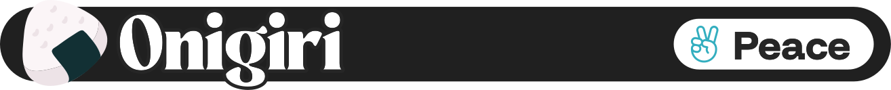
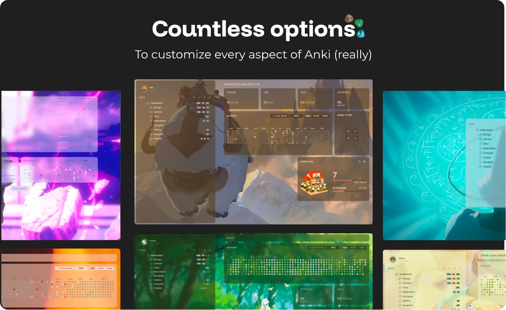

  

<h1 align="center">
	Onigiri
</h1>

Onigiri is an Anki add-on that transforms the standard interface into a modern, highly customizable dashboard. Make your study space your own with personalized themes and layouts, then add a little fun to your reviews with three mini-games, Pokémon companions, levels, and hexagon islands to build.

The name comes from *onigiri* (お握り), also called *omusubi* (おむすび): a Japanese rice ball. Just as a rice ball provides energy, Onigiri aims to give you an extra boost to come back to your flashcards, one review at a time.

### Get started

Install Onigiri from [AnkiWeb](https://ankiweb.net/shared/info/1011095603):

1. Open Anki and go to **Tools → Add-ons → Get Add-ons…**
2. Enter the add-on code **`1011095603`**.
3. Confirm the installation and restart Anki.

You can also browse the [GitHub releases](https://github.com/thepeacemonk/Onigiri/releases) for release notes and downloadable builds.

### How it started

For a long time, I heard that Anki was an incredible tool for learning and remembering almost anything. And it was. But I struggled to feel comfortable using its interface. I later came to understand how my experience with OCD made certain visual details especially distracting.

While preparing for medical school entrance exams, I began building the Anki experience I wished I had. I worked on Onigiri in the little free time I could find, experimented with designs, gathered feedback from Reddit, and went through months of trial and error. I was nervous about sharing something so personal, but I eventually released it.

What started as a small side project has since reached more than 140,000 people around the world. Knowing that Onigiri has helped other students feel more motivated to study is what keeps me building it.

### Philosophy

- **Anki is for everyone.**: People study differently. Everyone should be able to shape their study environment around their own needs, preferences, and routines.
- **Design can encourage consistency.**: Clear layouts, readable typography, and thoughtful details can reduce friction and make it easier to return each day. Good design can also [support motivation](https://www.mdpi.com/2414-4088/2/1/6).
- **Calm by default, powerful when you need it.**: The experience should feel simple from the start, with deeper customization available when you want it.
- **Personalization without losing familiarity.**: Onigiri builds around the Anki workflow you already know, rather than asking you to relearn how to study.

### Why Onigiri?

Anki already does an excellent job of helping people remember. Onigiri focuses on the experience *around* those reviews: the interface you open, the atmosphere you create, and the small rewards that make studying more enjoyable.

You don't need to change the way you learn. You can simply make the place where you learn feel more like yours.

### License

Onigiri is distributed under the **GNU General Public License v3.0 (GPL-3.0)**. See [LICENSE.txt](LICENSE.txt) for the full terms.

You can use, study, modify, and redistribute the GPL-covered code in accordance with the license. If you distribute modified versions, you must comply with its conditions, including the applicable source-code and license-notice requirements. The GPL also permits commercial use; it does not permit distributing GPL-covered derivatives under incompatible closed-source terms.

Please respect the time and care behind this project. If you build on Onigiri, preserve the required notices, follow the licenses of third-party assets, and consider crediting or contributing to the original project.

### Credits and acknowledgments

Onigiri draws inspiration from a generous community of designers, developers, and open-source projects:

- **Color palettes and themes:** [Catppuccin](https://github.com/catppuccin), [Dracula](https://draculatheme.com/), [Rosé Pine](https://rosepinetheme.com/palette/), [Nord](https://www.nordtheme.com/docs/colors-and-palettes), [Solarized](https://ethanschoonover.com/solarized/), and [Antinote](https://antinote.io/).
- **Visual inspiration:** [Mochi Cards](https://mochi.cards/).
- **Anki interface add-ons by Shige:** [Enhance main window](https://ankiweb.net/shared/info/911023479), [Rearrange home addons](https://ankiweb.net/shared/info/1797615099), and [Anki Re-design](https://ankiweb.net/shared/info/1959668791).
- **Functional and UI inspiration:** [Review Heatmap](https://ankiweb.net/shared/info/1771074083) by Glutanamite and [Modern Material Theme](https://ankiweb.net/shared/info/1321246682).
- **Hexagon tiles and buildings:** [Kenney](https://www.kenney.nl), under [CC0](http://creativecommons.org/publicdomain/zero/1.0/).
- **Pokémon sprites:** © Nintendo / Game Freak / The Pokémon Company, sourced from [PokéAPI sprites](https://github.com/PokeAPI/sprites) and [PokéSprite](https://github.com/msikma/pokesprite).
- **Onigimon mini-game:** Adapted from [Ankimon](https://github.com/Unlucky-Life/ankimon) by Unlucky-Life and h0tp, licensed under [GPL-3.0](https://github.com/Unlucky-Life/ankimon/blob/main/LICENSE).

### Notices

- **Independent project.** Onigiri is not affiliated with or endorsed by [Onigiri Anki](https://www.onigiri-anki.com/). This project is an Anki interface add-on; Onigiri Anki is a separate Japanese-learning product.
- **Optional support.** Onigiri is, and always will be, open-source and free to use. Donations and optional in-add-on purchases, such as mini-game coins or items, help support its continued development. They are not required to use the core add-on.

### Gratitude

Thank you to the **Anki** and [**Ankimon**](https://github.com/h0tp-ftw/ankimon) communities for helping me learn about programming and add-on development. I'm especially grateful to the small but dedicated development team on Discord and to my friends in the Ankimon community.

And to everyone who studies with Onigiri: thank you for giving this project a place in your daily routine.

For updates, previews, theme sharing, and conversations with other users, join the Onigiri community on Discord.

<a href="https://discord.gg/6kdG6tX5Mz">

  

</a>

### Support my work

Onigiri takes ongoing time and care to maintain. If it has made your study routine a little better, you can help support future updates through a voluntary contribution. Every bit of support is appreciated.

<a href="https://www.buymeacoffee.com/peacemonk">

  

</a>

## Star History

<a href="https://www.star-history.com/?repos=thepeacemonk%2Fonigiri&type=date&legend=top-left">
 <picture>
   <source media="(prefers-color-scheme: dark)" srcset="https://api.star-history.com/chart?repos=thepeacemonk/onigiri&type=date&theme=dark&legend=top-left" />
   <source media="(prefers-color-scheme: light)" srcset="https://api.star-history.com/chart?repos=thepeacemonk/onigiri&type=date&legend=top-left" />
   
 </picture>
</a>

## Onigiri previews

  

  

  

  

  

  

  

<a href="https://github.com/thepeacemonk/Onigiri/issues">

  

</a>
